# CentroTareas

**Autor:** Luis Antonio Vasquez Flores · **Curso:** Programación en Móviles · **Docente:** Juan León S. · Tecsup

App Android (Kotlin + Jetpack Compose + Material 3) con tres tareas que tardan: una tarea con barra de progreso, un cálculo pesado (contar números primos) y dos cargas de datos simuladas. Muestra cómo mantener la pantalla fluida con corrutinas, `viewModelScope`, `Dispatchers`, `Job`, `async` y manejo de errores, sin bloquear nunca el hilo principal. Usa solo datos ficticios.

## Estructura de paquetes

```
com.vasquez.centrotareas/
├── MainActivity.kt
├── model/
│   └── Estados.kt              PrimosUi, CargaUi
├── data/
│   ├── TareasRepository.kt     interface
│   └── TareasRepositoryLocal.kt  cargas simuladas y contarPrimos
├── viewmodel/
│   ├── TareasViewModel.kt
│   └── TareasViewModelFactory.kt
└── ui/
    ├── PantallaTareas.kt
    └── theme/                  Color.kt, Theme.kt
```

## Arquitectura MVVM + Repository

```
View (PantallaTareas)
   | eventos: botones                 ^ collectAsState()
   v                                  |
ViewModel (TareasViewModel) --- StateFlow --->
   | viewModelScope.launch { ... }
   v
TareasRepository (interface) ---> TareasRepositoryLocal
   (cargas simuladas y contar primos)
```

La vista solo conoce al ViewModel; el ViewModel solo conoce la interface del Repository; el Repository no sabe nada de la UI.

## Observación del Paso 1

**Qué pasa con la pantalla.** Al tocar «Tarea larga (MAL)» y enseguida «Tócame», durante 4 segundos nada responde: el contador no suma y la pantalla queda congelada hasta que termina la espera.

**Por qué no se ve «Trabajando...».** `tareaLargaMala()` cambia el mensaje a «Trabajando...» y después ejecuta `Thread.sleep(4000)` en el hilo principal. Ese mismo hilo es el que dibuja la pantalla, así que no puede actualizarla mientras duerme. Cuando por fin termina, el mensaje ya cambió a «Terminó» y es lo único que se llega a dibujar; «Trabajando...» nunca se pinta.

**Qué mostraría Android con 10 segundos.** Android mostraría el diálogo ANR («CentroTareas no responde»), con las opciones de cerrar la app o esperar, porque el hilo principal pasaría más de unos 5 segundos sin atender los toques. Lo comprobé incluso con la espera de 4 segundos: al tocar la pantalla varias veces mientras estaba congelada, apareció ese diálogo.

## Capturas

| 1. Pantalla congelada (ANR) | 2. Tarea cancelada |
|---|---|
| 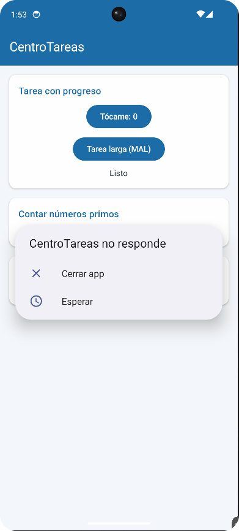 | 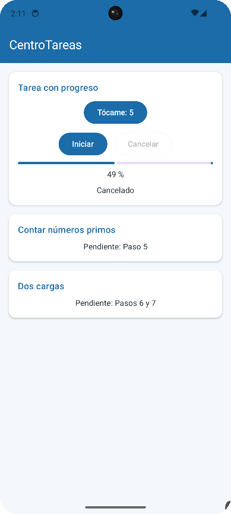 |
| Tarea mala en el hilo principal: la app deja de responder y Android muestra el diálogo ANR. | La barra se detuvo en 49 %, el mensaje dice «Cancelado» y Iniciar vuelve a estar disponible. |

| 3. Contar primos | 3b. Primos con un N muy grande |
|---|---|
| 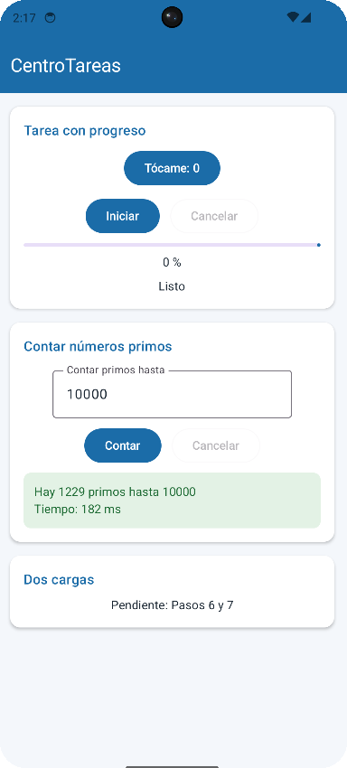 |  |
| Hay 1229 primos hasta 10000 (182 ms). | 3 001 134 primos hasta 50 000 000 en 72 470 ms, y la pantalla nunca se congeló. |

| 4a. Una por una | 4b. A la vez |
|---|---|
| 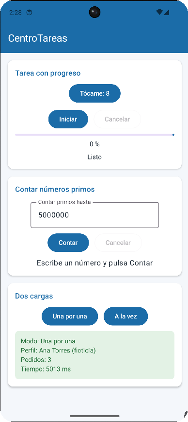 | 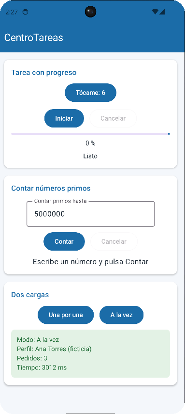 |
| Perfil y pedidos en secuencia: 5013 ms. | Con `async` en paralelo: 3012 ms. |

| 5. Error simulado | 5b. Reintento con éxito |
|---|---|
| 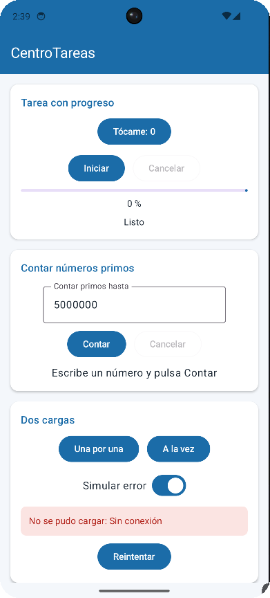 | 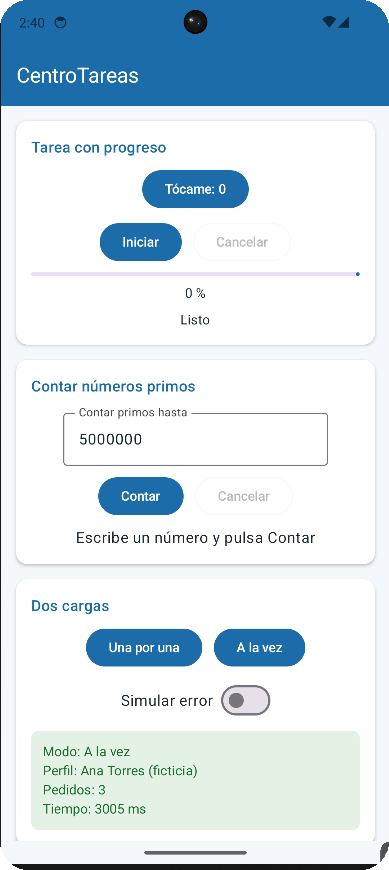 |
| Con «Simular error» activo sale el recuadro rojo y el botón Reintentar. | Al desactivar el interruptor y reintentar, carga bien (3005 ms). |

## Para pensar

**1. ¿Por qué no se veía «Trabajando...» en el Paso 1?**
Porque el cambio de mensaje y el `Thread.sleep` ocurren en el hilo principal, que también es el que redibuja la pantalla. Mientras duerme no puede dibujar, y cuando despierta el mensaje ya es «Terminó».

**2. ¿Qué diferencia hay entre `Thread.sleep` y `delay`?**
`Thread.sleep` bloquea el hilo donde se ejecuta: nadie más puede usarlo mientras espera. `delay` solo suspende la corrutina: libera el hilo para otras tareas y retoma después. Además `delay` revisa la cancelación; `Thread.sleep` no.

**3. ¿Por qué `Dispatchers.Default` para los primos y `Dispatchers.IO` para la red?**
`Default` tiene tantos hilos como núcleos de CPU y sirve para trabajo que usa mucho procesador, como contar primos. `IO` tiene un grupo mucho más grande de hilos, pensado para operaciones que pasan la mayor parte del tiempo esperando (red, disco), donde muchos hilos pueden estar bloqueados a la vez.

**4. ¿Qué pasaría con la corrutina si el usuario cierra la pantalla? ¿Qué papel cumple `viewModelScope`?**
Si la pantalla se cierra por completo, el ViewModel se destruye y `viewModelScope` cancela todas sus corrutinas, así que no queda trabajo huérfano ni fugas de memoria. Si solo se rota la pantalla, el ViewModel sobrevive y la tarea continúa sin reiniciarse.

**5. ¿Por qué `async` tarda 3 s y no 5 s? ¿Qué pasa si una de las dos cargas falla?**
Porque las dos cargas corren al mismo tiempo: el total es el de la más lenta (máximo entre 2 s y 3 s), no la suma. Dentro de `coroutineScope`, si una falla, la otra se cancela y la excepción sale por `await()`, donde la atrapa el `try/catch` que muestra el recuadro de error.

## Fase 2 · Mejoras con IA (rama `mejora-ia`)

Con Gemini mejoré CentroTareas sin romper MVVM + Repository. El registro de cada prompt está en [PROMPTS.md](PROMPTS.md).

| Mejora | Capas que cambia | Commit |
|---|---|---|
| Tema espacial: fondo con estrellas que viajan y paleta cósmica | View | `feat(tema)` |
| Avatares animados que reaccionan al estado de cada tarjeta | View | `feat(avatares)` |
| Primos con progreso, emitido como `Flow` desde el Repository | Repository, ViewModel, View | `feat(primos)` |
| Reintento automático con espera creciente (3 intentos) | ViewModel, View | `feat(reintento)` |
| Tabla de comparación de tiempos Una por una vs A la vez | ViewModel, View | `feat(comparacion)` |

| Tema espacial y avatares | Primos con progreso (Flow) |
|---|---|
| 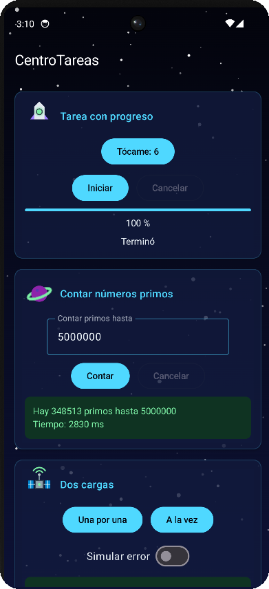 | 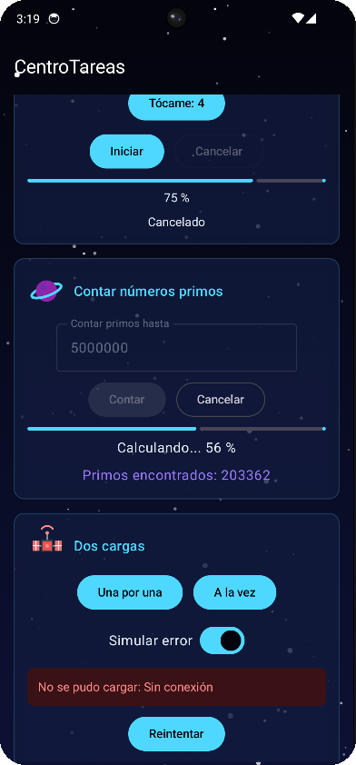 |
| Fondo de estrellas animado y un avatar por tarjeta: cohete, planeta y satélite. | El Repository emite el avance: «Calculando... 56 %» y el contador de primos en vivo. |

| Reintento automático | Comparación de tiempos |
|---|---|
| 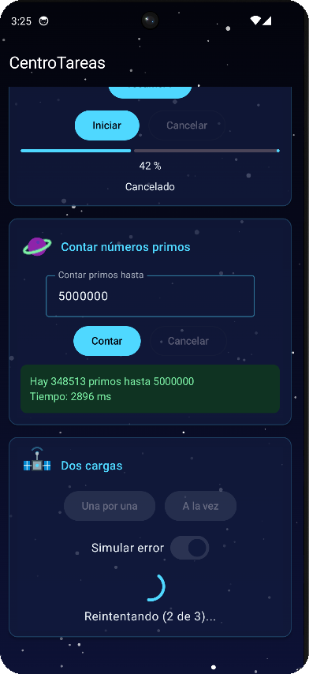 | 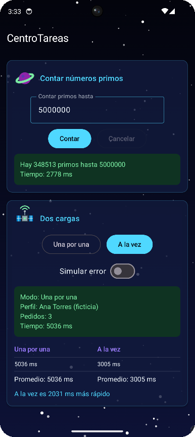 |
| Con «Simular error», «Reintentando (2 de 3)...» antes de mostrar el error. | A la vez es 2031 ms más rápido que Una por una. |
